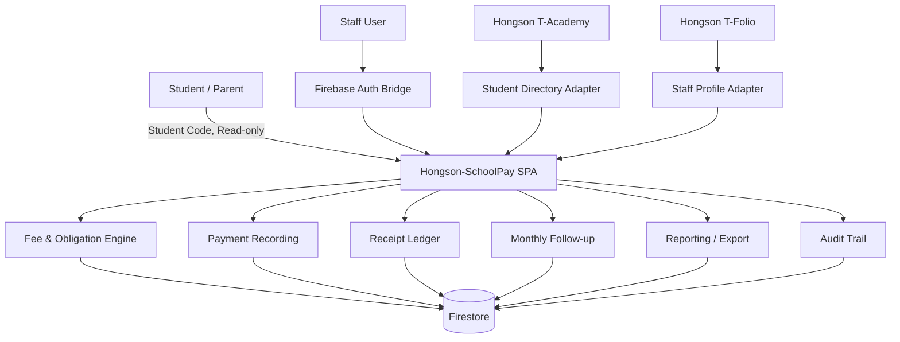

# Hongson-SchoolPay — Updated System Blueprint

**Revision:** Audit Consolidated 2026-10-04  
**Supersedes:** แนวคิดเดิมที่ให้ระบบออก/พิมพ์ใบเสร็จ และ Dual-Series Receipt Generator แบบดิจิทัล

---

## 1. Executive Summary

Hongson-SchoolPay คือระบบกลางสำหรับ **ติดตามภาระชำระของนักเรียน, บันทึกรับชำระ, เชื่อมโยงกับใบเสร็จจริงแบบเขียนมือ, ติดตามนักเรียนรายเดือน, ควบคุมสต็อกใบเสร็จ และสร้างรายงานที่โรงเรียน/สพฐ. ใช้จริง**

ระบบไม่ใช่ระบบบัญชีเต็มรูปแบบ และไม่ใช่ระบบสร้างใบเสร็จอิเล็กทรอนิกส์

### Core Principle

> **Database เป็น Source of Truth สำหรับสถานะและ Audit Trail ส่วนใบเสร็จเงินจริงยังคงเป็นเอกสารกระดาษเขียนมือที่เจ้าหน้าที่การเงินควบคุม**

---

## 2. Problem Statements

1. รายชื่อนักเรียนเปลี่ยนตามปี/ห้อง/สถานะ ทำให้การติดตามยอดค้างด้วย Excel แยกไฟล์คลาดเคลื่อนได้
2. ภาระที่ต้องชำระต่างกันตามระดับชั้น ห้อง และแผนการเรียน
3. ครูที่ปรึกษาต้องสรุปนักเรียนค้างชำระและจัดทำบันทึกข้อความทุกเดือน
4. งานการเงินต้องคุมใบเสร็จกระดาษเป็นเล่ม และต้องตรวจสอบได้ว่าแต่ละหน้าใช้กับรายการใด
5. ใบเสร็จถูกใช้รับเงินทั้งจากนักเรียนและเงินประเภทอื่นของโรงเรียน
6. ปลายปีงบประมาณต้องสรุปการใช้ใบเสร็จตามแบบ สพฐ. และไม่ควรคีย์ข้อมูลซ้ำจากศูนย์
7. ต้องเชื่อมข้อมูลนักเรียนและบุคลากรจากระบบที่โรงเรียนใช้อยู่แล้ว

---

## 3. Goals

### Functional Goals
- Student/Parent ตรวจสอบภาระและสถานะได้ด้วยรหัสนักเรียน
- ครูที่ปรึกษาเห็นเฉพาะนักเรียนที่รับผิดชอบและสร้างรายงานติดตามรายเดือน
- การเงินรับชำระและบันทึกข้อมูลอ้างอิงใบเสร็จจริงได้เร็ว
- ทุกใบในแต่ละเล่มตรวจสอบสถานะย้อนหลังได้
- Admin ตั้ง Fee Master และผูกภาระตามห้อง/แผนการเรียนได้
- รองรับ Other Receipt นอกเหนือค่าเทอม
- Export รายงาน สพฐ. และเอกสารราชการจากข้อมูลเดียว

### Non-functional Goals
- ใช้งานง่าย ลดจำนวนคลิก
- Audit-friendly
- Prevent duplicate / inconsistent receipt use
- ลดการคีย์ซ้ำ
- ระบบต้นทางยังเป็นเจ้าของข้อมูล Student/Staff
- Client-heavy เพื่อควบคุมต้นทุน

---

## 4. Stakeholders

### Public / Read-only Visitor
- นักเรียน / ผู้ปกครอง
- เข้าด้วยรหัสนักเรียน
- ไม่ใช่ Staff RBAC role

### Staff Roles
1. `superadmin`
2. `executive`
3. `finance_officer`
4. `finance_teacher`
5. `homeroom_teacher`

> Staff Profile มาจาก Hongson T-Folio/Auth Bridge ส่วนสิทธิ์เฉพาะ SchoolPay เก็บแยกในระบบ SchoolPay

---

## 5. External Systems

### Hongson T-Academy
Source of truth สำหรับ:
- รหัสนักเรียน
- ชื่อ-นามสกุล
- ชั้น/ห้อง
- แผนการเรียน
- สถานะนักเรียนล่าสุด
- ประวัติการย้ายห้องที่จำเป็นต่อการปรับภาระ

### Hongson T-Folio
Source of truth สำหรับ:
- ชื่อครู/บุคลากร
- Profile ขั้นพื้นฐาน
- Record ที่ติดมากับบัญชีผู้ใช้งาน

### Firebase Auth Bridge
ใช้ยืนยันตัวตน Staff และ map UID ไปยัง Role/Permission ของ SchoolPay

---

## 6. High-level Architecture



---

## 7. Bounded Contexts

### 7.1 Student Directory Context
- Cache/snapshot เฉพาะข้อมูลที่ต้องใช้
- ไม่ให้ครูการเงินแก้ชื่อ/ห้องต้นทางจาก SchoolPay โดยตรง
- มี `sourceUpdatedAt` เพื่อบอก freshness

### 7.2 Fee / Obligation Context
- Fee Master
- Annual/Term Template
- Room/Program Assignment
- Student Obligation
- Waive/Adjust/Transfer ตาม lifecycle

### 7.3 Payment Context
- รับเงินจริงของนักเรียน
- แยก Payment ออกจาก Receipt Reference
- รองรับ partial/multi-item payment หากการเงินจริงต้องใช้

### 7.4 Other Receipt Context
- เงินรับที่ไม่ใช่ Student Obligation
- เลือก Category / Source / Description / Amount
- ใช้ Receipt Ledger เดียวกัน

### 7.5 Physical Receipt Control Context
- Receipt Stock Batch
- Receipt Book
- Receipt Page 1–50
- Issue/Use/Void/Return/Reconciliation
- หลายเล่ม Active พร้อมกันได้

### 7.6 Homeroom Monthly Follow-up Context
- Monthly snapshot ตามห้อง
- Follow-up reason / solution / parent need
- Memo Generation

### 7.7 Report Context
- Monthly DOCX Memo
- Receipt Control Ledger
- OBEC Excel Forms
- Annual Report
- Receipt Book Return/Reconciliation

---

## 8. Critical Business Rules

### BR-001: No Receipt Printing
Webapp ห้าม generate, print, download หรือสร้างใบเสร็จรับเงินจริงในรูปแบบใด ๆ

### BR-002: Receipt Is Physical
ทุก Payment/Other Receipt ที่มีใบเสร็จ ต้องอ้างอิง Receipt Page จริง

### BR-003: 50 Pages per Book
Receipt Book ปกติมี 50 หน้า

### BR-004: Receipt Page Unique Use
Receipt Page หนึ่งหน้าห้ามใช้กับ Transaction มากกว่าหนึ่งรายการรับเงิน เว้นแต่ Finance กำหนดให้หนึ่งใบครอบคลุมหลาย line items ใน Transaction เดียวกัน

### BR-005: VOID Is Immutable History
VOID แล้วห้ามย้อนเป็น AVAILABLE โดยการแก้ตรง ๆ ต้องใช้ correction event ที่มีสิทธิ์และ Audit Log

### BR-006: Multi-active Books
ระบบต้องรองรับ Receipt Book หลายเล่มสถานะ ACTIVE พร้อมกัน

### BR-007: Student and Other Receipt Are Separate Sources
Other Receipt ไม่สร้างหนี้/ภาระให้นักเรียน

### BR-008: Source Data Ownership
ชื่อ/ห้องนักเรียนมาจาก T-Academy; Staff Profile มาจาก T-Folio/Auth Bridge

### BR-009: Student View History
Student/Parent ต้องเรียกดูประวัติอย่างน้อย 2 ปีการศึกษา

### BR-010: Official Form Export
ห้ามสร้างแบบรายงานใหม่แทนแบบ สพฐ. หากมี Template จริงที่กำหนด ต้องเติมข้อมูลลง Template นั้น

---

## 9. Receipt Baseline FY 2570

ข้อมูลที่ยืนยันล่าสุดสำหรับการออกแบบ:

| Source | Range | Quantity |
|---|---|---:|
| ยกมาจากปีงบประมาณ 2569 | `28ก83122–28ก83128` | 6 เล่ม |
| รับปีงบประมาณ 2570 | `30ก58379–30ก58458` | 80 เล่ม |
| **รวมบริหารในปีงบประมาณ 2570** |  | **86 เล่ม** |

> Migration ต้องยึดรายการในทะเบียนคุมจริงและ quantity ที่ฝ่ายการเงินยืนยัน ไม่ให้ระบบคำนวณจำนวนเล่มจากการตีความ Range String เพียงอย่างเดียว

---

## 10. Application Modules

```text
/                         Landing
/student                  Student/Parent read-only lookup
/student/history          2-year payment history
/student/documents        ประกาศ/เอกสารการเรียกเก็บที่อนุญาตให้ดูหรือดาวน์โหลด

/app                      Staff authenticated shell
/app/dashboard            Role-based dashboard
/app/homeroom             ห้องในที่ปรึกษา
/app/monthly-followup      ติดตามรายเดือน
/app/memos                 บันทึกข้อความ
/app/finance/payments      รับเงินนักเรียน
/app/finance/other         รับเงินประเภทอื่น
/app/receipts/books        ทะเบียนคุมเล่ม
/app/receipts/pages        ตรวจสอบรายหน้า
/app/fees                  Fee Master
/app/assignments           Room/Program Fee Assignment
/app/reports               Report Center
/app/admin/users           Role/Permission
/app/audit                 Audit Log
```

---

## 11. Technology Direction

### Frontend
- Vite
- React
- TypeScript
- Responsive UI
- Design system: White / Green / Silver

### Backend Services
- Firebase Auth
- Firestore
- Optional Firebase Storage สำหรับประกาศ/เอกสารที่โรงเรียนอัปโหลด

### Hosting
- Vercel Static Hosting

### Integration Layer
ห้ามให้ Component query ระบบต้นทางโดยกระจายทั่วแอป ให้ใช้ Adapter:

```ts
interface StudentDirectoryAdapter {
  getStudent(studentCode: string): Promise<StudentProfile | null>
  getRoomRoster(roomId: string, academicYear: number, term: number): Promise<StudentProfile[]>
}

interface StaffProfileAdapter {
  getCurrentStaff(uid: string): Promise<StaffProfile | null>
}
```

---

## 12. Security Principles

- Staff ใช้ Firebase Auth + App-specific RBAC
- Student/Parent lookup เป็น read-only และคืนเฉพาะข้อมูลที่จำเป็น
- ห้ามเปิด collection-wide public read ของนักเรียน
- หากใช้ student-code-only ตาม Requirement ให้พิจารณา Firebase Anonymous Auth + App Check + query path ที่จำกัด และไม่แสดงข้อมูลติดต่อ/ข้อมูลครอบครัวที่ไม่จำเป็น
- Financial mutations require authenticated staff + role validation
- Audit log สำหรับ create/update/void/return/correction/export สำคัญ

---

## 13. Deprecated from Old Blueprint

รายการต่อไปนี้ **ไม่ใช่ Core Requirement หลัง Audit** และห้าม Coding Agent นำกลับมาเอง:
- Digital receipt generation
- Print receipt button สำหรับ Student/Parent
- PDF receipt
- Receipt running number ที่ระบบสร้างเพื่อแทนเอกสารจริง
- แนวคิดว่ามี Active Receipt Book ได้เพียงเล่มเดียว
- การเอาเงินทุน/เงินอุดหนุนทุกชนิดไปสร้างหนี้นักเรียน

รายการ Legacy ที่ยังไม่ถูกยืนยันใน Audit ล่าสุด เช่น PromptPay slip upload / Parent notice letter ให้ถือเป็น `OPTIONAL_FUTURE` จนกว่าจะยืนยันอีกครั้ง

