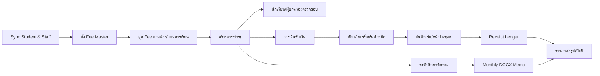

# Hongson-SchoolPay — Workflow Specification

**Revision:** 2026-10-04 Audit Consolidated

---

## 1. End-to-End Master Workflow



---

## 2. Landing / Entry Workflow

### Student / Parent
```text
หน้าแรก
→ Tab นักเรียน/ผู้ปกครอง
→ กรอกรหัสนักเรียน
→ ดึงข้อมูลล่าสุดจาก T-Academy
→ แสดงข้อมูล read-only
```

### Staff
```text
หน้าแรก
→ Tab ครู/บุคลากร
→ Login ผ่าน Firebase Auth Bridge
→ ดึง Staff Profile จาก T-Folio
→ อ่าน hsp_roles
→ Redirect Dashboard ตาม Role
```

---

## 3. Student / Parent Workflow

### 3.1 Current Status
```text
กรอกรหัสนักเรียน
→ Profile + ชั้น/ห้อง
→ ภาระทั้งหมด
→ ชำระแล้ว
→ ค้างชำระ
→ รายการรายบรรทัด
```

### 3.2 Receipt Detail — View Only
```text
รายการที่ชำระแล้ว
→ ดูรายละเอียด
→ แสดงวันที่รับเงิน / จำนวนเงิน
→ แสดงเล่มใบเสร็จจริง
→ แสดงหน้า/เลขที่ใบเสร็จจริง
→ สถานะ USED / VOID ตามสิทธิ์การมองเห็น
```

**ไม่มีปุ่ม Print/Download Receipt**

### 3.3 Two-year History
```text
ประวัติการชำระ
→ ปีการศึกษา [ปัจจุบัน / ย้อนหลัง 1 ปี]
→ ภาคเรียน
→ รายการ + สถานะ + Receipt Reference
```

### 3.4 Finance Announcements / Fee Notice
```text
เมนูเอกสาร
→ ประกาศการเรียกเก็บเงินบำรุงการศึกษา/เอกสารที่ Admin อนุญาต
→ View / Download เอกสารประกาศ
```

> Download ได้เฉพาะประกาศ/เอกสารประชาสัมพันธ์ ไม่ใช่ใบเสร็จ

---

## 4. Homeroom Teacher Workflow

### 4.1 Dashboard
```text
Login
→ Autofill ครู + ห้องที่รับผิดชอบ
→ จำนวนนักเรียน
→ ชำระครบ
→ ค้างชำระ
→ รายการต้องติดตาม
```

### 4.2 Monthly Follow-up
```text
เลือกเดือน + ห้อง
→ ระบบ Snapshot รายชื่อนักเรียน
→ กรองผู้ค้างชำระ
→ ครูกรอกเฉพาะ:
   - สาเหตุการค้าง
   - แนวทางแก้ไข/ความต้องการของผู้ปกครอง
   - บันทึกการติดตาม
→ ระบบคำนวณ:
   - นักเรียนทั้งหมด
   - ชำระครบ
   - ค้างชำระ
   - ยอดค้างรวม
→ ตรวจ Preview
→ Generate DOCX บันทึกข้อความ
→ พิมพ์เอกสารกระดาษ
→ เข้าสายอนุมัติ
```

### 4.3 Monthly Memo Approval Chain
```text
ครูที่ปรึกษา
→ งานการเงินและบัญชี
→ หัวหน้ากลุ่มบริหารงานงบประมาณ
→ รองผู้อำนวยการกลุ่มบริหารงานงบประมาณ
→ ผู้อำนวยการ
```

ระบบอย่างน้อยต้องเก็บสถานะว่าเอกสารอยู่ขั้นใด แม้การลงนามจริงอาจยังเป็นกระดาษ

---

## 5. Finance — Student Payment Workflow

```text
ค้นหานักเรียน
→ ตรวจสอบภาระที่ยังเปิดอยู่
→ เลือกรายการที่รับเงินจริง
→ กรอกจำนวนเงิน/วิธีรับเงิน/หมายเหตุ
→ บันทึก Payment
→ เจ้าหน้าที่เขียนใบเสร็จจริงด้วยมือ
→ เลือก Receipt Book ที่กำลัง Active
→ เลือกหน้า AVAILABLE
→ กรอก/ตรวจเล่ม + หน้า/เลขที่ + ผู้รับเงิน
→ Confirm “บันทึกข้อมูลใบเสร็จจริง”
→ Page เปลี่ยน AVAILABLE → USED
→ Payment เชื่อม receiptPageId
→ Audit Log
```

### Validation
- ห้ามใช้หน้า USED ซ้ำ
- ห้ามใช้หน้า VOID
- รองรับ Active Book หลายเล่ม
- Payment บันทึกก่อนได้ แต่ต้องมีสถานะ `receipt_reference_pending` จนกว่าจะผูกใบเสร็จ หากนโยบายการเงินอนุญาต

---

## 6. Finance — Other Receipt Workflow

ใช้สำหรับเงินที่ไม่ได้เป็นภาระของนักเรียน

```text
เมนู “รับเงินประเภทอื่น”
→ เลือกหมวดเงิน
→ กรอกรายละเอียด/แหล่งเงิน/ผู้จ่าย
→ จำนวนเงิน
→ วันที่รับ
→ ผู้รับเงิน
→ บันทึก Other Receipt Transaction
→ เขียนใบเสร็จจริงด้วยมือ
→ เลือกเล่ม/หน้า AVAILABLE
→ บันทึก Reference
→ Page → USED
→ ข้อมูลเข้า Annual/OBEC Report
```

ตัวอย่าง Category จากข้อมูลจริง:
- เงินทุนการศึกษา
- เงินอุดหนุน/จัดสรรงบประมาณ
- เงินบริจาค
- เงินสนับสนุนกิจกรรมพิเศษ
- เงินหลักค้ำประกัน/หลักประกัน
- เงินค่าอาหารกลางวัน
- เงินนักเรียนพักนอน
- ปัจจัยพื้นฐานนักเรียนยากจน / กสศ.
- อื่น ๆ

---

## 7. Receipt Stock Workflow

### 7.1 Receive Stock
```text
รับใบเสร็จจากส่วนกลาง/ยอดยกมา
→ บันทึก fiscalYear
→ series/book range
→ จำนวนเล่ม
→ ระบบสร้าง ReceiptBook records
→ แต่ละเล่มสร้าง ReceiptPage 1..50
→ status IN_STOCK / AVAILABLE
```

### 7.2 Issue / Open Book
```text
เลือกเล่ม IN_STOCK
→ ระบุผู้รับผิดชอบ
→ วันที่เบิก
→ เปิดใช้
→ Book = ACTIVE
```

> ทำซ้ำได้หลายเล่มพร้อมกัน

### 7.3 Use Page
```text
Book ACTIVE
→ เลือก Page AVAILABLE
→ ผูกกับ Payment หรือ Other Receipt
→ Page = USED
```

### 7.4 Void Page
```text
Page AVAILABLE หรือกรณีเขียนผิด
→ เลือก VOID
→ บังคับกรอกเหตุผล
→ ผู้ทำรายการ + timestamp
→ Page = VOID
→ ห้ามลบ
```

### 7.5 Return / Close Book
```text
เจ้าหน้าที่นำเล่มคืน
→ ตรวจ 50 หน้า
→ Count USED + VOID + AVAILABLE
→ ตรวจ reconciliation = 50
→ บันทึกวันที่คืน / ผู้ส่งคืน / ผู้รับคืน
→ หากยังมีใบเหลือและนโยบายอนุญาต: Returned with balance
→ หากใช้ครบ: CLOSED/RETURNED
→ สร้างข้อมูลสำหรับรายงานสิ้นปี
```

---

## 8. Fee Master / Room Assignment Workflow

```text
Admin เปิดปีการศึกษา/ภาคเรียน
→ คัดลอก Fee Master จากปีก่อน หรือสร้างใหม่
→ จัดหมวด
→ กำหนด frequency
→ เลือกระดับชั้น/ห้อง/แผนการเรียน
→ ใส่อัตราของแต่ละรายการ
→ Preview ยอดรวม
→ Publish Template
→ Generate Obligations ให้นักเรียนใน scope
```

### Rule
การ Generate ต้องใช้ Roster ล่าสุดจาก T-Academy และเก็บ `assignmentVersion` เพื่อย้อนดูได้ว่าหนี้ถูกสร้างจาก Template เวอร์ชันใด

---

## 9. Student Lifecycle Workflow

### ย้ายห้อง
```text
T-Academy แจ้ง Room ใหม่
→ Compare Template ห้องเดิม/ใหม่
→ ไม่ลบ Payment เดิม
→ ปรับเฉพาะ Obligation ที่ยังไม่ชำระตาม Rule
→ Audit Adjustment
```

### ลาออก/ย้ายสถานศึกษา
```text
Student status เปลี่ยน
→ Stop future obligation generation
→ ภาระเปิดเดิมเข้าสู่ Review
→ Finance/Admin waive/void ตามนโยบาย
→ เก็บเหตุผลและ Audit
```

---

## 10. Reporting Workflow

### Monthly
```text
Homeroom Snapshot
→ Follow-up Data
→ Generate DOCX
→ Print Memo
```

### Fiscal Year
```text
Receipt Stock Opening
+ Receipt Book Movement
+ Page Usage
+ VOID
+ Other Receipt
+ Return/Reconciliation
→ Transform ตาม Mapping
→ เติมลง Template Excel สพฐ.
→ Validation
→ Export XLSX
```

### Reports Allowed to Print/Export
- บันทึกข้อความรายเดือน
- แบบตรวจสอบการใช้ใบเสร็จ
- รายงานการใช้ใบเสร็จประจำปี
- ทะเบียนคุมใบเสร็จ
- รายงานรับ/ค้างชำระ
- เอกสารคืนเล่ม/สรุปคืนเล่ม

### Output Explicitly Forbidden
- ใบเสร็จรับเงินจริงจากระบบ

