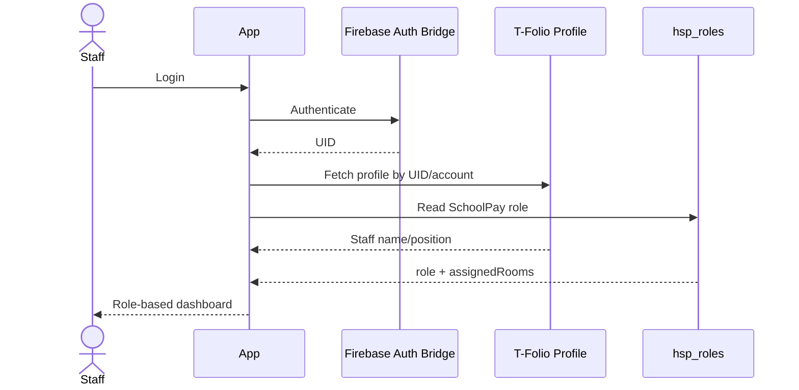

# Hongson-SchoolPay — Roles, Permissions & Authentication

**Revision:** 2026-10-04 Audit Consolidated

---

## 1. Identity Model

มีผู้ใช้งาน 2 กลุ่มที่แตกต่างกัน

### A. Student / Parent Visitor
- เข้าด้วย Student Code ตาม Requirement
- Read-only
- ไม่ใช้ Staff Role
- เห็นข้อมูลของนักเรียนคนนั้นเท่านั้น

### B. Authenticated Staff
- Login ผ่าน Firebase Auth Bridge
- Profile จาก Hongson T-Folio
- SchoolPay Role จาก `hsp_roles`

---

## 2. Canonical Staff Roles

### `superadmin`
- จัดการ Role/Permission
- Master Data ทั้งระบบ
- Fee Master
- Report/Export
- Audit
- Correction พิเศษตามสิทธิ์

### `executive`
- Dashboard รวม
- Report read
- Memo review/approval status
- ไม่บันทึกรับเงินประจำวันโดยปกติ

### `finance_officer`
- งานการเงินเต็ม
- Fee setup ตามที่ได้รับมอบหมาย
- Student payment
- Other receipt
- Receipt stock/book/page
- Report/Export
- Reconciliation/Return

### `finance_teacher`
- งานรับชำระ/ตรวจสอบ/บันทึกใบเสร็จจริง
- Report operational
- สิทธิ์ Master Data อาจจำกัดตามนโยบาย

### `homeroom_teacher`
- เห็นเฉพาะห้องที่ได้รับมอบหมาย
- Follow-up รายเดือน
- Generate DOCX memo
- ดูสถานะการชำระ
- ไม่แก้ Transaction การเงิน

---

## 3. Permission Matrix

| Capability | Student/Parent | Homeroom | Finance Teacher | Finance Officer | Executive | Superadmin |
|---|:---:|:---:|:---:|:---:|:---:|:---:|
| ดูข้อมูลนักเรียนตนเอง | ✓ | - | - | - | - | - |
| ดูประวัติย้อนหลัง 2 ปี | ✓ | ห้องตนเอง | ✓ | ✓ | ✓ | ✓ |
| ดู Receipt Reference | ของตนเอง | ห้องตนเอง | ✓ | ✓ | ✓ | ✓ |
| พิมพ์ใบเสร็จ | **No** | **No** | **No** | **No** | **No** | **No** |
| รับเงินนักเรียน | No | No | ✓ | ✓ | No | ✓ |
| รับเงินประเภทอื่น | No | No | ✓* | ✓ | No | ✓ |
| ผูกเล่ม/หน้าใบเสร็จ | No | No | ✓ | ✓ | No | ✓ |
| VOID Receipt Page | No | No | ตามสิทธิ์ | ✓ | No | ✓ |
| เปิด/คืน Receipt Book | No | No | ตามสิทธิ์ | ✓ | Read | ✓ |
| Follow-up รายเดือน | No | ✓ | Read | Read | Read | ✓ |
| Generate Memo DOCX | No | ✓ | ✓ | ✓ | Read | ✓ |
| Fee Master | No | No | Read/limited | ✓ | Read | ✓ |
| Room Fee Assignment | No | No | Read/limited | ✓ | Read | ✓ |
| OBEC Export | No | No | ✓ | ✓ | ✓ | ✓ |
| User/Role Admin | No | No | No | No | Read | ✓ |
| Audit Log | No | Own limited | Limited | ✓ | Read | ✓ |

`*` ปรับได้ตามนโยบายโรงเรียน

---

## 4. Auth Flow



---

## 5. Student Code Lookup Security

Requirement ปัจจุบันคือกรอกรหัสนักเรียนเพียงอย่างเดียว

### Minimum Safety Rules
- Return เฉพาะข้อมูลด้านการชำระที่จำเป็น
- ไม่แสดงที่อยู่ เบอร์โทร ผู้ปกครอง หรือข้อมูลละเอียดที่ไม่เกี่ยวกับ SchoolPay
- ไม่เปิด Firestore collection public read แบบ query อิสระ
- ใช้ controlled lookup path / anonymous auth / App Check ตามสถาปัตยกรรมที่เลือก
- UI ไม่ expose internal IDs ที่ไม่จำเป็น
- Log abnormal repeated lookup หากทำได้

> หากภายหลังโรงเรียนต้องการ Privacy สูงขึ้น สามารถเพิ่ม second factor แบบเบา ๆ ได้ แต่ไม่ถือเป็น Requirement ปัจจุบัน

---

## 6. Assigned Room Rules

`homeroom_teacher`:
- `assignedRooms[]`
- Query/data access ต้องบังคับทั้ง UI และ Security Rules
- หากมีหลายห้อง แสดง Room Switcher
- ห้ามแก้ assignedRooms จากหน้า Profile ตัวเอง

---

## 7. Finance Separation of Duties

แนะนำให้รองรับ Permission ย่อย แม้ Role จะชื่อเดียวกัน เช่น

```ts
permissions = {
  canReceiveStudentPayment: true,
  canReceiveOtherMoney: true,
  canVoidReceiptPage: false,
  canIssueReceiptBook: false,
  canReturnReceiptBook: false,
  canPublishFeeTemplate: false,
  canExportObecReport: true
}
```

เพื่อให้โรงเรียนสามารถแบ่งหน้าที่ตามบุคลากรจริงโดยไม่ต้องสร้าง Role จำนวนมาก

---

## 8. Sensitive Actions Requiring Reason

- Reverse Payment
- VOID Receipt Page
- Waive/void Student Obligation
- Change published Fee Assignment
- Correct Receipt Reference
- Reopen returned/closed book

ทุก action ต้องมี reason และ Audit Log

