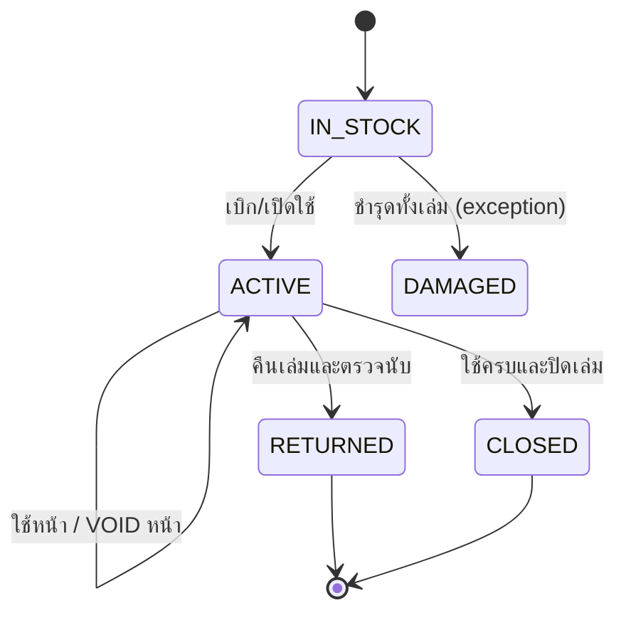
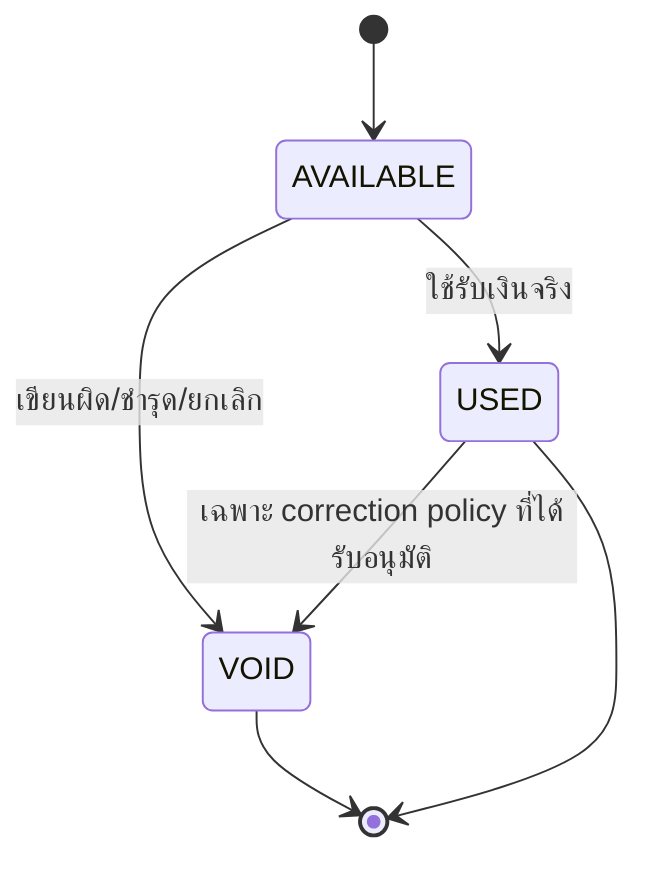

# Hongson-SchoolPay — Physical Receipt Control Specification

**Revision:** 2026-10-04 Audit Consolidated

---

## 1. Core Rule

ใบเสร็จรับเงินจริงของโรงเรียนเป็น **เอกสารกระดาษเขียนมือโดยเจ้าหน้าที่การเงิน**

Hongson-SchoolPay ทำหน้าที่เป็น **Digital Control Ledger** เท่านั้น

```text
เงินจริงรับเข้า
→ เจ้าหน้าที่เขียนใบเสร็จจริง
→ ระบบบันทึกว่าใช้ “เล่มไหน / หน้าไหน”
→ ตรวจสถานะย้อนหลังได้
```

---

## 2. Physical Unit

### Receipt Book
- 1 เล่ม = 50 ใบ/หน้า
- มี `bookNo` เช่น `30ก58379`
- อยู่ภายใต้ fiscal year

### Receipt Page
- pageNo 1–50
- status:
  - `AVAILABLE`
  - `USED`
  - `VOID`

---

## 3. Book Lifecycle



### Important Audit Change
**ACTIVE สามารถมีหลายเล่มพร้อมกันได้**

UI และ schema ห้ามใช้ assumption `currentReceiptBookId` แบบ global เดียว

---

## 4. Page Lifecycle



ไม่มี transition กลับ AVAILABLE แบบ edit ธรรมดา

---

## 5. Page Usage Data

เมื่อ Page = USED ต้องรู้ขั้นต่ำ:
- bookNo
- pageNo / printedReceiptNo ถ้ามี
- transactionType
- transactionId
- moneyCategory
- amount
- payer/student/source
- receiver
- date

ทำให้ผู้ใช้ค้น `30ก58379 / หน้า 12` แล้วเห็นได้ทันทีว่า:
- ใช้แล้วหรือยัง
- ใช้รับเงินอะไร
- จำนวนเท่าไร
- ของใคร/จากแหล่งใด
- ใครรับเงิน

---

## 6. Concurrent Active Books

ตัวอย่าง:

```text
30ก58379  ACTIVE  Holder: ครู A  Available 18/50
30ก58380  ACTIVE  Holder: ครู B  Available 43/50
28ก83128  ACTIVE  Holder: งานการเงิน  Available 7/50
```

Payment UI:
1. เลือก Book
2. ระบบแสดงเฉพาะ AVAILABLE pages
3. เลือก Page
4. Transaction บันทึกและ lock Page

---

## 7. Opening Stock FY 2570

Confirmed requirement input:

| รายการ | ช่วงเล่ม | จำนวน |
|---|---|---:|
| ยอดยกมาจากปีงบ 69 | 28ก83122–28ก83128 | 6 |
| รับใบเสร็จปีงบ 70 | 30ก58379–30ก58458 | 80 |
| **รวมปีงบ 70** |  | **86** |

### Migration Rule
เก็บ `quantityConfirmed` แยกจาก textual range เพราะข้อมูลทะเบียนจริงอาจมีเหตุการณ์เบิกก่อน/หลังที่ทำให้ Range กับยอดคงเหลืออ่านแบบ inclusive ตรง ๆ ไม่ได้

---

## 8. Receipt Stock Ledger

ต้องรองรับมุมมองเหมือนทะเบียนคุมจริง:

| วันที่ | รายการ | รับ | จ่าย | คงเหลือ | เล่ม/ช่วงเลขที่ | ผู้รับ | สถานะ |
|---|---|---:|---:|---:|---|---|---|

Movement ทุกครั้ง immutable

---

## 9. VOID Rules

VOID ต้องมี:
- reason
- actor
- timestamp
- book/page
- linked transaction เดิม ถ้ามี

### Forbidden
- Delete VOID record
- Recycle VOID page
- เปลี่ยนเลข page เพื่อปิดช่องว่าง

---

## 10. Book Return / Reconciliation

Audit ล่าสุดเพิ่ม Requirement เรื่อง **ส่งคืนเล่มใบเสร็จรับเงิน**

เมื่อคืนเล่ม:

```text
USED count
+ VOID count
+ AVAILABLE count
= 50
```

หากไม่เท่ากับ 50 ระบบ block confirmation และแจ้ง discrepancy

บันทึก:
- returnedBy
- receivedBy
- returnedAt
- counts
- note

---

## 11. Fiscal Year Closing

ก่อน Export สิ้นปี:

Checklist:
- Opening stock recorded
- Received during year recorded
- Every issued book has holder
- Active books reviewed
- Returned books reconciled
- Every used page linked to transaction
- Every void page has reason
- Stock balance reconciles

---

## 12. Search & Audit Views

### Book View
- all 50 pages as grid
- green/gray/red status
- filters

### Page View
- exact page details
- timeline
- transaction link

### Movement View
- received
- issued
- returned
- closed

---

## 13. Naming Guideline

ใช้คำใน UI:
- `ใบเสร็จจริง`
- `ทะเบียนคุมใบเสร็จ`
- `บันทึกข้อมูลใบเสร็จจริง`
- `เล่ม/หน้า`
- `สถานะใบเสร็จ`

หลีกเลี่ยง:
- `Generate Receipt`
- `Print Receipt`
- `Download Receipt`
- `ออกใบเสร็จจากระบบ`

